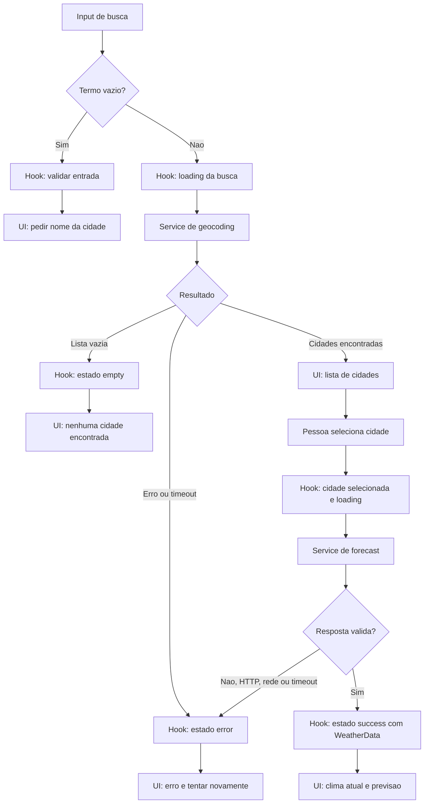

# Plano Técnico: Weather App

Fonte da verdade: [`specs/weather-app-spec.md`](../specs/weather-app-spec.md). Este plano define arquitetura e contratos para a v1; não contém implementação final.

## Architecture

Aplicação cliente estática, sem backend e sem autenticação. Separar o sistema em camadas pequenas, com fluxo de dependências unidirecional:

```text
components -> hooks -> services -> Open-Meteo
  |          |          |
  +--------> lib <------+  (funções puras; sem I/O ou estado)
       types        (contratos compartilhados)
```

- `components/` recebe props e emite eventos; renderiza conteúdo e estados acessíveis. Não faz `fetch`, não normaliza payloads externos e não coordena requisições.
- `hooks/` orquestra busca, seleção, estado de carregamento/erro/vazio, retry e invalidação de respostas obsoletas. Depende de interfaces/funções de serviço, não de detalhes HTTP.
- `services/` é o único ponto de acesso às APIs: constrói requests, aplica timeout, valida JSON e normaliza os campos Open-Meteo para os tipos do domínio.
- `lib/` contém funções puras para conversão/formatação de temperatura, datas e códigos meteorológicos. Não importa React, serviços nem componentes.
- `types/` declara contratos de domínio compartilhados e não contém lógica.
- `App.tsx` compõe componentes e mantém a unidade escolhida; não replica lógica de rede.

Não adicionar biblioteca de estado global. Temperaturas permanecem em Celsius, sem arredondamento, no domínio; a conversão e o arredondamento ocorrem somente na apresentação.

## Tech Stack

- TypeScript strict, React 19 e Vite 8.
- Tailwind CSS para estilos, conforme o projeto.
- pnpm como gerenciador; Node.js 22 ou superior.
- Vitest e Testing Library para testes unitários/de componentes; Playwright para E2E.
- Biome para lint e formatação.
- `fetch` nativo e `AbortController` para chamadas HTTP e timeout. Sem chave de API ou dependência de backend.
- Para o requisito WCAG, usar uma verificação automatizada de acessibilidade no fluxo E2E; adicionar `@axe-core/playwright` como dependência de desenvolvimento se ainda não estiver disponível.

## Project Structure

Reutilizar os arquivos existentes; adicionar novos somente se uma implementação específica exigir.

```text
src/
  App.tsx                         # composição da página e unidade ativa
  components/
    SearchBar.tsx                 # entrada e submissão da busca
    CurrentWeather.tsx            # condições atuais
    ForecastList.tsx              # previsão de cinco dias
    ForecastCard.tsx              # resumo de um dia
    UnitToggle.tsx                # controle Celsius/Fahrenheit
    states/                       # vazio, loading e erro acessíveis
  hooks/
    useWeather.ts                 # estado e operações de consulta
  lib/
    temperature.ts                # conversão e formatação
    format.ts                     # rótulos e datas locais
    weatherCodes.ts               # código Open-Meteo para condição pt-BR
  services/
    weatherService.ts             # geocoding, forecast, validação e mapping
  types/
    weather.ts                    # modelos e erros de domínio
  styles/index.css

tests/
  unit/                           # serviços, lógica pura e componentes
  e2e/                            # fluxos principais e responsividade
```

Limites de dependência: componentes importam tipos e funções de apresentação de `lib/`, além de receberem estado/ações do hook ou de `App`; somente o hook chama `services/`; somente o serviço conhece URLs, parâmetros e formatos brutos da Open-Meteo. `lib/` e `types/` não dependem das demais camadas.

## Data Model

Contratos normalizados para a UI. Campos meteorológicos individuais podem estar ausentes; o serviço os normaliza para `null`. Respostas sem os objetos principais ou sem cinco datas são inválidas.

```ts
type Unit = 'celsius' | 'fahrenheit';

type NullableNumber = number | null;

interface City {
  /** Identificador da localidade no geocoding. */
  id: number;
  /** Nome da cidade retornado pela busca. */
  name: string;
  /** País, quando fornecido pelo geocoding. */
  country?: string;
  /** Estado ou região administrativa, quando disponível. */
  admin1?: string;
  /** Latitude usada na consulta meteorológica. */
  latitude: number;
  /** Longitude usada na consulta meteorológica. */
  longitude: number;
}

interface CurrentWeather {
  /** Horário local da observação atual, em ISO 8601. */
  time: string;
  /** Temperatura atual em Celsius, antes de arredondar para exibição. */
  temperatureC: NullableNumber;
  /** Código WMO da condição meteorológica atual. */
  weatherCode: number | null;
  /** Umidade relativa atual, em porcentagem. */
  humidityPercent: NullableNumber;
  /** Velocidade atual do vento, em km/h. */
  windSpeedKmh: NullableNumber;
  /** Pressão à superfície, em hPa. */
  pressureHpa: NullableNumber;
  /** Precipitação atual, em milímetros. */
  precipitationMm: NullableNumber;
}

interface ForecastDay {
  /** Data local do dia previsto, no formato YYYY-MM-DD. */
  date: string;
  /** Código WMO da condição meteorológica diária. */
  weatherCode: number | null;
  /** Temperatura mínima diária em Celsius. */
  minTemperatureC: NullableNumber;
  /** Temperatura máxima diária em Celsius. */
  maxTemperatureC: NullableNumber;
  /** Probabilidade máxima diária de precipitação, em porcentagem. */
  precipitationProbabilityPercent: NullableNumber;
}

interface WeatherData {
  /** Cidade cujas coordenadas originaram os dados. */
  city: City;
  /** Fuso IANA retornado pelo forecast para a cidade. */
  timezone: string;
  /** Condições atuais normalizadas. */
  current: CurrentWeather;
  /** Previsão local normalizada; o serviço valida exatamente cinco dias. */
  forecast: ForecastDay[];
}

type WeatherOperation = 'geocoding' | 'forecast';
type WeatherErrorKind = 'timeout' | 'network' | 'http' | 'invalid-response';

interface WeatherError {
  operation: WeatherOperation;
  kind: WeatherErrorKind;
  message: string; // mensagem pt-BR para apresentação
}
```

Invariantes:

- Geocoding retorna zero a cinco cidades; uma cidade só fica selecionada após ação explícita da pessoa usuária.
- Temperaturas no domínio são sempre Celsius, sem arredondamento.
- A previsão normalizada contém exatamente cinco datas consecutivas locais.
- Campo JSON individual ausente/nulo vira `null`; valor numérico inválido ou estrutura principal inválida gera `invalid-response`.
- A unidade não é persistida; cada carregamento da aplicação inicia em Celsius.

## Data Flow

1. A pessoa submete a busca. A UI remove espaços nas extremidades; entrada vazia não faz requisição.
2. `useWeather` inicia busca e `weatherService.searchCities` codifica o nome via `URLSearchParams` e solicita até cinco resultados.
3. Lista vazia vira estado `empty`; não há chamada de previsão. Resultados são apresentados sem seleção automática.
4. Ao iniciar uma nova busca, limpar a cidade selecionada e os dados meteorológicos anteriores. A seleção explícita de um resultado define a nova cidade, inicia loading e chama `getWeather` com suas coordenadas.
5. O serviço valida e normaliza a resposta. Só publica resultado se a requisição ainda corresponder à seleção atual; respostas obsoletas são ignoradas.
6. A UI renderiza dados, placeholders `—` e unidades. Alternar unidade recalcula a exibição dos valores originais sem requisição externa.
7. Retry repete a última operação que falhou: busca com o mesmo termo ou previsão para a mesma cidade.



## External APIs

### Geocoding

- **URL:** `GET https://geocoding-api.open-meteo.com/v1/search?name=Campinas&count=5&language=pt&format=json`.
- **Parâmetros:** `name` é o termo aparado e codificado com `URLSearchParams`; `count=5` limita a resposta; `language=pt` solicita nomes em português quando disponíveis; `format=json` solicita JSON.
- **Resposta resumida:**

```json
{
  "results": [
    {
      "id": 123456,
      "name": "Campinas",
      "latitude": -22.91,
      "longitude": -47.06,
      "country": "Brasil",
      "admin1": "São Paulo"
    }
  ]
}
```

- **Mapeamento para `City`:** `id`, `name`, `country`, `admin1`, `latitude` e `longitude` são copiados para os campos homônimos. `country` e `admin1` são opcionais; não inventar dados ausentes. `results` ausente ou vazio normaliza para lista vazia, não para erro de rede.

### Forecast

- **URL:** `GET https://api.open-meteo.com/v1/forecast`.
- **Parâmetros:**
  - `latitude` e `longitude`: coordenadas da `City` selecionada.
  - `current=temperature_2m,weather_code,relative_humidity_2m,wind_speed_10m,surface_pressure,precipitation`.
  - `daily=weather_code,temperature_2m_max,temperature_2m_min,precipitation_probability_max`.
  - `forecast_days=5` e `timezone=auto` para cinco datas no fuso local da cidade.
  - `temperature_unit=celsius`, `wind_speed_unit=kmh` e `precipitation_unit=mm`; pressão usa hPa.
- **Resposta resumida:**

```json
{
  "timezone": "America/Sao_Paulo",
  "current": {
    "time": "2026-11-05T12:00",
    "temperature_2m": 23.4,
    "weather_code": 2,
    "relative_humidity_2m": 64,
    "wind_speed_10m": 11.5,
    "surface_pressure": 924.2,
    "precipitation": 0
  },
  "daily": {
    "time": ["2026-11-05", "2026-11-06", "2026-11-07", "2026-11-08", "2026-11-09"],
    "weather_code": [2, 3, 61, 2, 1],
    "temperature_2m_min": [16, 17, 18, 16, 15],
    "temperature_2m_max": [25, 26, 23, 24, 25],
    "precipitation_probability_max": [10, 20, 70, null, 0]
  }
}
```

- **Mapeamento para `WeatherData`:** associar a `City` selecionada e `timezone` retornado. De `current`, mapear `time` → `time`, `temperature_2m` → `temperatureC`, `weather_code` → `weatherCode`, `relative_humidity_2m` → `humidityPercent`, `wind_speed_10m` → `windSpeedKmh`, `surface_pressure` → `pressureHpa` e `precipitation` → `precipitationMm`.
- **Mapeamento para `ForecastDay`:** percorrer os cinco índices de `daily.time`; para cada índice `i`, mapear `time[i]` → `date`, `weather_code[i]` → `weatherCode`, `temperature_2m_min[i]` → `minTemperatureC`, `temperature_2m_max[i]` → `maxTemperatureC` e `precipitation_probability_max[i]` → `precipitationProbabilityPercent`. Código meteorológico é convertido em rótulo pela camada `lib/weatherCodes.ts`.
- Campo individual ausente ou `null` vira `null` no modelo e é exibido como `—`. `current` ou `daily` ausente, timezone inválido, arrays desalinhados estruturalmente ou menos de cinco datas geram erro recuperável; nunca preencher precipitação ausente com zero.
- Sem polling, retry automático ou provedor de fallback. Confirmar cotas, disponibilidade e atribuição exigida pelo Open-Meteo antes do lançamento.

## State Management

Manter uma máquina de estados pequena no hook, sem store global:

```ts
type WeatherStatus =
  | 'idle'
  | 'loading-search'
  | 'results'
  | 'loading-weather'
  | 'success'
  | 'empty'
  | 'error';

interface WeatherViewState {
  status: WeatherStatus;
  query: string;
  cities: City[];
  selectedCity: City | null;
  data: WeatherData | null;
  error: WeatherError | null;
}
```

- `App.tsx` mantém `unit: Unit`, inicializado como `celsius`.
- `useWeather` expõe operações `search`, `selectCity` e `retry`; retry guarda a operação e seus argumentos.
- Cada nova busca/seleção invalida a requisição anterior por contador de sequência ou mecanismo equivalente. Não introduzir cache ou persistência.
- Ao iniciar outra busca, não apresentar o clima anterior como pertencente à nova cidade.

## Error Handling

- Timeout por requisição: 10 segundos com `AbortController`; limpar temporizador em sucesso, erro ou cancelamento.
- HTTP não-2xx, falha de rede, JSON inválido, objetos obrigatórios ausentes ou previsão com menos de cinco datas: encerrar loading, emitir `WeatherError` e oferecer retry manual.
- Erros individuais não estruturais: manter o registro e mapear o campo ausente para `null`, renderizado como `—`.
- Geocoding vazio: estado `empty` com “Nenhuma cidade encontrada”; não mostrar como erro nem chamar forecast.
- Erro em região acessível (`role="alert"`); carregamento em região de status (`role="status"`, anúncio polido). Mensagens em pt-BR e retry por botão/teclado.
- Não repetir automaticamente erro HTTP ou timeout; evitar carga duplicada no provedor e manter retry sob controle da pessoa usuária.

## Testing Strategy

- **Funções puras (`lib/`, Vitest):** testar Celsius/Fahrenheit nos dois sentidos, valores negativos e ponto de congelamento, arredondamento somente na formatação, conversões repetidas sem perda acumulada, códigos meteorológicos conhecidos/desconhecidos e datas/rótulos locais. Esses testes não montam React nem fazem I/O.
- **Serviços (`services/`, Vitest com `fetch` mockado):** verificar URL e parâmetros de geocoding e forecast; busca aparada/codificada, até cinco resultados e resposta vazia; mapeamento de cada campo Open-Meteo; valores ausentes/null; HTTP 429/5xx, falha de rede, timeout em 10 s, JSON inválido, ausência de `current`/`daily`/timezone e forecast com arrays desalinhados ou menos de cinco datas. Confirmar também que timeout cancela o request e que retry não é automático.
- **Hooks (`hooks/`, Testing Library com serviços mockados):** verificar estados idle/loading/results/success/empty/error, busca vazia sem chamada, seleção explícita, associação da cidade aos dados, retry da operação e argumentos corretos, nova busca limpando dados anteriores e resposta obsoleta ignorada. Não repetir aqui testes de serialização HTTP.
- **Componentes (`components/`, Testing Library):** testar os estados requeridos separadamente: loading (`role="status"` e texto), erro (`role="alert"` e botão de retry), vazio (nenhuma cidade), sucesso (cidade, unidades, métricas e cinco dias); também nomes acessíveis, operação por teclado e conversão visual quando muda a unidade. Componentes recebem dados/handlers controlados, sem rede.
- **Playwright (E2E):** cobrir o fluxo completo de busca, lista sem seleção automática, seleção de resultado, condições atuais, cinco dias e alternância de unidade; cenários de input vazio, nenhum resultado, erro + retry e ausência de associação com cidade antiga. Interceptar APIs com respostas determinísticas, incluindo uma resposta atrasada para validar concorrência.
- **Viewport mobile:** executar o fluxo principal em 320 px e verificar que busca, seleção, alternância e dados continuam acessíveis e que `scrollWidth <= clientWidth`; manter também um smoke em desktop. Não duplicar em E2E todos os casos de payload já cobertos no serviço.
- **Acessibilidade:** incluir checagem automatizada sem violações críticas/graves e navegação por teclado para busca, seleção, unidade e retry.
- **API real:** testes bloqueantes usam mocks para não depender de rede, cota ou disponibilidade externa. Uma chamada real pode existir como smoke manual/não bloqueante antes do lançamento.
- **Gate do projeto:** `pnpm lint`, `pnpm build`, `pnpm test` e `pnpm test:e2e`.

## Risks & Trade-offs

- **Estado React local em hook vs. store global/React Query:** manter hook e estado local porque há uma cidade ativa, sem cache nem sincronização; store/cache adicionaria dependências e invalidação antes de existir necessidade de produto. Reconsiderar apenas se histórico, várias cidades ou cache entrarem no escopo.
- **`fetch` mockado vs. API real nos testes bloqueantes:** mocks dão respostas determinísticas para falhas, timeout e payloads raros; testes live são mais próximos do provedor, mas flakey, sujeitos a cota e indisponibilidade. Manter live apenas como smoke não bloqueante.
- **Testes por camada vs. muitos E2E:** testes unitários/integração localizam falhas com rapidez; E2E cobrem poucos caminhos de alto valor ponta a ponta. Evitar testar cada variação de payload via navegador.
- **Validar exatamente cinco dias vs. renderizar dias recebidos:** rejeitar estrutura com menos de cinco dias mantém promessa e UI consistentes; tolerar dias parciais reduziria falhas, mas poderia apresentar previsão incompleta como completa. Campos individuais permanecem tolerantes via `null`.
- **Retry manual vs. retry automático:** retry manual evita chamadas duplicadas e consumo de cota; automático poderia melhorar recuperação transitória, mas exige política de backoff e limites não definidos pela spec.
- **Sem atualização automática vs. polling:** economiza tráfego e evita complexidade de ciclo de vida; os dados podem envelhecer numa sessão. A v1 refaz a consulta ao selecionar outra cidade ou após erro.
- **Sem provedor de fallback vs. continuidade durante indisponibilidade:** um segundo provedor aumentaria resiliência, mas exige contratos, unidade/semântica equivalentes e custo de integração; fora da v1.
- **Divergências atuais a resolver durante implementação:** o hook existente seleciona automaticamente o primeiro resultado; os tipos existentes tornam métricas obrigatórias; o serviço atual converte probabilidade diária ausente em `0` e não valida cinco datas; não há proteção completa contra respostas obsoletas. A implementação deve obedecer à spec antes de considerar os critérios concluídos.
